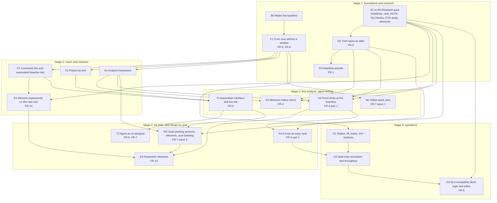

# Roadmap

Written 2026-11-10 by the lead session, as architect (decision record 0006), from the owner's feature list in `docs/feature-requests.md`. **Stage 1 is finished and merged into `master`** (2026-11-10, pull request #17; summary below). Stage 2 is next and not started; it waits for the owner's word. It says what has to come before what, and what can run side by side.

Rewrite a stage's section when its plan changes; move a finished stage to a one-line summary at the top. Each stage runs on its own integration branch (decision record 0004).

## The shape of it

Three things in the owner's list are foundations that most of the others stand on:

1. **A core that runs without a window.** Today the model cannot be loaded, changed or exported without the widgets. Until it can, there are no automated tests, no tooling for an agent (FR-5), and every analysis feature has to be built into the screens.
2. **Train types as data.** Heartline presets (FR-1), radius limits (FR-3), force limits by restraint and per-seat forces (FR-4), more types (FR-9) and the train in the throughput simulation (FR-6) all need one definition of a train.
3. **An analysis framework.** The radius check and the force check are the same kind of thing: walk the track, compare with a limit, report where it fails, show it. Build the frame once.

So the roadmap is those three first, with research running beside them from the first day, then the features in the order their dependencies allow. FR-7, the main goal, starts as a study in Stage 1 and delivers in waves from Stage 3, because its best ideas need the foundations.

## What must be serial, and what can run together

**Serial (each waits for the one before):**

- B0 (a wider baseline) before F1: F1 must not change what the program computes, and today's baseline is one four-section track.
- F1 before F2, F3, A1, T2, W1 and everything after them. F1 rewrites how `core/` and `ui/` meet, so it touches most files in both. **While F1 is open, no other piece may change `core/` or the widgets it touches.** This is the one real bottleneck in the roadmap.
- R1 (heartline research) before D2 (the data), before D3 (the picker).
- A1 (framework) before A2 and A3 (the checks). A3 before A4.
- T2 before T3. O1 before O2 before O3.

**Parallel (safe to run at the same time):**

- All six research tasks, with each other and with F1. They produce documents, not code.
- D2 and D3 beside F1, on one condition: they add new files and change only `ui/trackproperties.*`, which F1 agrees to leave until D3 is merged.
- F2, F3 and A1 with each other, once F1 is in.
- A2, A3, T2 and W1 with each other.
- A4, W2 and T3 with each other.
- FR-9 (more train types) at any time after D2: each type is a data entry.

Two pieces can share a stage only if they do not edit the same files. The lead checks that when cutting the pieces, and gives each its own worktree.

## Stage 1: foundations and research (finished 2026-11-10)

Done on `claude/stage-1` in eighteen planned pieces and four that came up on the way; decision records 0007, 0008 and 0009; `STATUS.md` has what was verified.

| Piece | What it delivered |
|---|---|
| B1, B2, B0 | A batch mode in the program and `tools/run-baseline.py`: eight projects compared with the 2016 binary with no tolerance, five of them generated by the program itself, an undo and redo round trip, the importers. |
| F1a to F1h | Nothing in `core/` names a window. A console program built from `core/` alone (`fvdcore`) loads, computes, exports and saves with identical files. A guard script, per-folder notes, the map rewritten. |
| N1, N2 | Why the owner's project differed from the 2016 binary (one C maths function), and the change that removed the difference (`core/fvdmath.*`). |
| R1 to R6 | The research notes in `docs/research/`. |
| D2, D2b, D3 | `data/traintypes.json` with 64 train types, its loader and test, the "Train type" list in Track Properties. |

**What Stage 1 changed in the plan for later stages:**

- **Undo was not split (decision record 0009).** Every edit becoming a core function, and undo with it, is piece T1 in Stage 2. The undo check found eight kinds of edit that undo gets wrong today (issue #31); T1 fixes them.
- **F2 is smaller:** the one-command baseline exists. F2 builds the command-line front end on `fvdcore`.
- **A2 (minimum radius) cannot rest on published numbers:** R2 found that no manufacturer publishes them. The check derives limits from speed and the force limit and lets the owner enter track and train limits he knows.
- **A3 (force limits) can be built from public sources,** with twelve numbers of lower confidence that the owner would transcribe from the standard if he buys it (R3).
- **O3 (block logic) should not aim at running NoLimits 2 scripts unchanged:** R4 recommends reproducing NoLimits 2's standard automatic block behaviour. The owner's decision, before Stage 5.
- **W2 has its shortlist (R5):** pinned points with a slack piece, built on a goal-seeking solver; then keep-shape-or-keep-forces per element, transitions that end at a value, a knock-on view. The owner ranks them.
- **Parametric elements (FR-10) have their first findings (R6):** goals must be independent, an element can promise its exit height or its exit speed but not both, and the solver needs a search for a valid start. E1 repeats the experiments on the real core.
- **Float maths is pinned where it matters and listed where it is not** (N2): five more C maths functions differ from the 2016 binary in the last digit without reaching any file yet.

## Stage 2: reach and measure

**Goal.** The program can be driven and checked without a person, and there is a place for analysis to live.

| Piece | What | Depends on | Who |
|---|---|---|---|
| **F2** | A command-line front end (load, summarise, export, run checks) on the window-less core. The one-command baseline comparison already exists since Stage 1 (pieces B1 and B2); F2 moves it from the windowed program's batch mode onto the core-only program. | F1 | Sonnet |
| **T1** | The command list: every edit a person can make becomes a core function and a named command with typed parameters, units and a description; the window's controls call the commands; undo and redo record them and replace today's `undoAction`. The eight undo defects of issue 31 are fixed here, command by command. Decision record 0009. | F1 | lead for the design, Opus to build, in small groups of commands each checked by the undo round trip |
| **F3** | The project as text: a readable description of a project that can be written and read back, beside the binary `.fvd`. The binary format stays as it is. | F1 | Sonnet; Opus for the round-trip tests |
| **A1** | The analysis framework: a check returns findings (where, value, limit, severity); findings show as marks on the 3D view and the plots, and as a report from the command line. One trivial check to prove it. | F1 | Opus for the design, Sonnet to build |
| **E1** | Element experiments on the real core (FR-10): R6's protocols re-run through the command line (a solved camelback, the exit contract, limits as inputs, a second element that turns or rolls), then the written design, **E2**, with the owner's choices. Scripts only; nothing changes in the program. | F2, R6 | Opus |

## Stage 3: first analysis, agent tooling, first FVD wave

| Piece | What | Depends on | Who | Requests |
|---|---|---|---|---|
| **T2** | The automation interface: the command list callable from outside, the live link into the running window, snapshots of the view, compact summaries of a track, and a tool server for Claude sessions. | F2, F3 | lead and Opus | FR-5 |
| **A2** | Minimum radius check. | A1, D2, R2 | Sonnet | FR-3 |
| **A3** | Force limits at the heartline: durations and combined directions by restraint class. Adds the along-track force, which the program does not store today. | A1, D2, R3 | Opus | FR-4 |
| **W1** | Editor quick wins chosen from R5 (candidates: copy, paste and mirror sections; edit several at once; faster recompute). | F1, R5 | Sonnet | FR-7 |

**The owner's part.** Rank R5's shortlist: it decides what W1 and W2 are.

## Stage 4: the train, and design by goal

| Piece | What | Depends on | Who | Requests |
|---|---|---|---|---|
| **A4** | Forces at every seat: a train on the track (cars, couplings, seat positions) and the acceleration at each seat, checked against the same limits. | A3, D2 with seat geometry | Opus | FR-4 |
| **W2** | The big FVD improvements chosen from R5 (candidates: sections that solve for a goal such as an end height or position; parametric elements; banking computed for a target lateral force; limits shown live while editing). | A1, T2, R5 | lead and Opus | FR-7 |
| **T3** | The agent as co-designer: build and adjust a layout from a description through T2, using the checks to judge its own work. | T2, A2, A3 | lead | FR-5, FR-7 |
| **E3** | Parametric elements as designed in E2: an element expands into ordinary sections, re-solves when what comes before it changes, and can be converted to plain sections. First element: the camelback. A saved-file version bump is likely. | E2, W2 (the solver), A3; A4 for the all-seats option | lead and Opus | FR-10 |

## Stage 5: operations

| Piece | What | Depends on | Who | Requests |
|---|---|---|---|---|
| **O1** | Station, lift, brake, trim and transport sections, exported to NoLimits 2 as such where the format allows. | F1 | Sonnet | FR-6 |
| **O2** | A circuit with several trains: dispatch, block travel times, waiting, riders per hour. | O1, A4 | Opus | FR-6 |
| **O3** | Block logic compatible with NoLimits 2 and its editor, to the depth R4 finds feasible. | O2, R4 | lead and Opus | FR-6 |

## Not on the roadmap

- **macOS** (FR-2): a non-goal by the owner's word.
- **Qt 6** (issue #3): Qt 5.15 builds the code. Revisit when Qt 5.15 becomes hard to install or a feature needs Qt 6. F1 makes the port smaller, because less code will touch the widgets.
- **The `.3ds` export:** waits for the owner's decision in issue #13.

## Risks the architect is watching

- **F1 is large and touches everything.** It is cut into pieces that each keep the baseline comparison passing, and it lands before any feature that would have to be rebased across it.
- **The baseline covers little.** One four-section track and three exporters. B0 widens it before F1 starts; F2 then makes running it one command.
- **R3 may find that the limits cannot be reproduced freely.** Then the check ships with the structure and the owner enters the numbers from his own copy of the standard.
- **R4 may find that running NoLimits 2 block scripts unchanged is out of reach.** Then FR-6 is rescoped to NoLimits 2's standard block behaviour before any of Stage 5 is built.
- **FR-7 has no finish line.** Each wave is chosen from a ranked list and judged by whether the owner builds a layout faster with it.

## Decisions that are the owner's

Everything about how to build this is the architect's call. These are not:

1. Whether FR-7's study (R5) may take an hour of his time for questions.
2. Which train types come first (FR-1, FR-9).
3. The ranking of FR-7's directions after R5.
4. Whether to buy the ASTM standard if R3 says it is needed.
5. How much NoLimits 2 script compatibility is worth if R4 says full compatibility is very large.
6. When to start Stage 1. (Given on 2026-11-10.)
7. For FR-10, after R6 and E1: which numbers define each first element, whether elements hold their position by default, and whether files with elements may stop opening in the 2016 program.
