# Roadmap

Written 2026-11-10 by the lead session, as architect (decision record 0006), from the owner's requests in `docs/feature-requests.md`. **Reworked the same day, after Stage 1, to take in FR-10 to FR-18** (issues #28 and #30; decision record 0010 says what changed and why). Stage 1 is finished and in `master`. **Stage 2 is finished** (2026-11-12, on the integration branch `claude/stage-2`; decision records 0011, 0012 and 0013) and reaches `master` when the owner merges pull request #46. Stage 3 is next.

The roadmap says what has to come before what, and what can run side by side. Rewrite a stage's section when its plan changes; move a finished stage to a short summary. Each stage runs on its own integration branch (decision record 0004). The order of the requests is the owner's to change; the last section lists what is asked of the owner and by when.

## Where each request is in the plan

| Request | Pieces | Stage |
|---|---|---|
| FR-1 Heartline per train type | D2, D3 | done (Stage 1) |
| FR-2 No macOS build | none | a non-goal |
| FR-3 Minimum radius check | A1 (done), then A2 | 2, 3 |
| FR-4 Ride-force limits, every seat | A3 at the heartline; A4 at every seat | 3; 6 |
| FR-5 Tooling for Claude | F2, T1, F3 (done); T2; T3 | 2; 3; 5 |
| FR-6 Throughput and blocks | O1, O2, O3 | 7 |
| FR-7 Better force vector design | W1, G1; G2, G3, G4; then E3, D4, T3 | 3; 4; 5 |
| FR-8 Refactor for agents | F1 | done (Stage 1); large files are split as they are touched |
| FR-9 More train types | data entries | any time |
| FR-10 Parametric elements | E1 trials (done); E2 design; E3 build | 2; 4; 5 |
| FR-11 The train as a train | R7 experiment (done); P1; P2 | 2; 3; 6 (R7 recommends P2's first step right after 3) |
| FR-12 Close the circuit | E1 trial (done); G2 | 2; 4 |
| FR-13 Energy margin | R8 (done); P1 and A6 | 2; 3 |
| FR-14 Ride rules | D4 | 5 |
| FR-15 Import and convert | I1 analyse; R11 experiment; I2 segment and fit | 3; before 6; 6 |
| FR-16 Launches, lifts, brakes, switches, swing launches | R9 (done); P3 lifts, launches, brakes; P4 swing launches, P5 switches | 2; 4; 7 |
| FR-17 Comfort beyond the standard | R10 (done); A7 | 2; 3 |
| FR-18 Ride sheet | A5 | done (Stage 2) |

## The shape of it

Eighteen requests rest on seven shared pieces. Each is built once, before the features that stand on it. Two exist since Stage 1 and two more since Stage 2 (the command list, and measures and findings); the rework of 2026-11-10 named the last five.

1. **A core that runs without a window** (F1, done). Everything automated stands on it.
2. **Train types as data** (D2, done). Heartlines, limits, seats and car lengths are fields of one train definition.
3. **The command list** (T1, done). Every edit a person can make is one named command with its own undo. The solver, elements, ride rules and the agent tooling all change a track through it, so a solve or a rule change is one undo step and the tooling cannot drift from the program.
4. **Measures and findings** (A1, done; wider than first planned). A *measure* is a number at every point of the track that the program works out beside the design without changing it: the along-track force, the curve radius, the jerk, the roll rate. A *finding* is a place where a measure breaks a limit. The radius check, the force limits, comfort, the energy margin, the ride sheet and the read-out of every solver result are all measures and findings.
5. **The solver** (G1). It changes the values the designer frees until a goal is met. Aiming a section at a height, pinned points, closing the circuit, parametric elements and fitting an imported track are the same engine with different goals.
6. **Riding the finished track** (P1, then P2). Today the program only *designs*: it shapes the track from the forces asked for, at the one speed the design assumes. A second computation takes the finished shape as given and moves a point, later a whole train, over it. That is what answers "does it still clear this hill with more friction", "what forces does an imported NoLimits track have", "what does the rear car feel", and it is what swing launches and several trains on a circuit need.
7. **One way to add to the saved file** (F4). Pins, elements, ride rules, launches and end-at-a-value transitions each need new fields in the project file. They get one mechanism, designed once, instead of a new file version per feature.

```mermaid
flowchart TD
    subgraph S1[Stage 1, done: foundations and research]
        F1[F1 Core runs without a window]
        D2[D2 Train types as data, D3 heartline picker]
        R[R1 to R6 Research]
    end
    subgraph S2[Stage 2, done: reach and measure]
        F2[F2 Command line]
        T1[T1 Command list, replaces undo]
        F3[F3 Project as text]
        A1[A1 Measures and findings]
        A5[A5 Ride sheet<br/>FR-18]
        E1[E1 Solver and element trials<br/>FR-7, FR-10, FR-12]
        RR[R7 to R10 Research, second pack<br/>FR-11, 13, 16, 17]
    end
    subgraph S3[Stage 3: see the ride, aim a section]
        A2[A2 Minimum radius<br/>FR-3]
        A3[A3 Force limits at the heartline<br/>FR-4]
        A7[A7 Comfort<br/>FR-17]
        P1[P1 Ride the finished track]
        A6[A6 Energy margin<br/>FR-13]
        I1[I1 Analyse an imported track<br/>FR-15]
        W1[W1 Knock-on view]
        G1[G1 Goal-seeking solver]
        T2[T2 Automation interface<br/>FR-5]
    end
    subgraph S4[Stage 4: hold the ride together]
        F4[F4 One way to add to the saved file]
        G4[G4 Transitions that end at a value]
        P3[P3 Lifts, launches, brakes, trims<br/>FR-16]
        G2[G2 Pinned points, close the circuit<br/>FR-12]
        G3[G3 Keep shape or keep forces]
        E2[E2 Design for elements]
    end
    subgraph S5[Stage 5: elements and rules]
        E3[E3 Parametric elements<br/>FR-10]
        D4[D4 Ride rules<br/>FR-14]
        T3[T3 Agent as co-designer]
    end
    subgraph S6[Stage 6: the train]
        P2[P2 The train as a train<br/>FR-11]
        A4[A4 Forces at every seat<br/>FR-4]
        I2[I2 Segment and fit<br/>FR-15]
    end
    subgraph S7[Stage 7: operations and special track]
        O1[O1 Station, transport, blocks]
        P4[P4 Swing launches]
        P5[P5 Switches and transfer track]
        O2[O2 Several trains, throughput]
        O3[O3 Block logic<br/>FR-6]
    end
    F1 --> F2 & T1 & F3 & A1
    A1 --> A5
    F2 --> A5 & E1
    R --> E1
    A1 --> A2 & A3 & A7 & P1
    D2 --> A2 & A3
    RR --> A7 & A6 & P3 & P2
    P1 --> A6 & I1 & G3 & P2
    F2 --> W1 & T2
    F3 --> T2 & F4
    T1 --> G1 & T2 & G4 & P3
    E1 --> G1 & E2
    F4 --> G4 & P3 & G2 & G3 & E3 & D4 & P5
    G1 --> G2 & E2 & T3 & I2
    W1 --> G2
    P3 --> G2 & O1 & P4
    E2 --> E3
    G4 --> E3 & D4
    A3 --> E3 & A4 & T3
    T2 --> T3
    I1 --> I2
    P2 --> A4 & O2 & P4
    O1 --> O2 --> O3
    P5 --> O3
```

## What must be serial, and what can run together

**Serial (each waits for the one before):**

- **T1 was Stage 2's bottleneck,** as F1 was Stage 1's, and is done: every edit of a track is a named command. A new kind of edit is added as a command first (`core/CLAUDE.md`), then given its control.
- A1 before every check and measure (A2, A3, A5, A6, A7) and before P1, which reports through it.
- E1 (trials by script) before G1 (the solver in the program) before G2 (pins) before E3 (elements).
- P1 before A6, I1, G3 and P2. P2 before A4, P4 and O2.
- **F4 before the first feature that adds to the saved file:** G4, P3, G2, G3, E3, D4, P5. Nothing before Stage 4 changes what a project computes or how it is saved.
- T2 before T3. P3 before O1 before O2 before O3.
- Each research note before the piece it feeds: R7 before P2, R8 before A6, R9 before P3, R10 before A7, R11 before I2.

**Parallel (safe to run at the same time):**

- In Stage 3, every piece with every other, except that A6 and I1 follow P1: each is a new measure, a new computation or a new panel.
- In Stage 4, after F4: G4, P3 and G3 with each other; G2 after G4 and P3.
- FR-9 (more train types) at any time: each type is a data entry.

Two pieces share a stage only if they do not edit the same files. The lead checks that when cutting the pieces, and gives each its own worktree.

## Stage 1: foundations and research (finished 2026-11-10)

Done on `claude/stage-1` in eighteen planned pieces and four that came up on the way; decision records 0007, 0008 and 0009; `STATUS.md` has what was verified.

| Piece | What it delivered |
|---|---|
| B1, B2, B0 | A batch mode in the program and `tools/run-baseline.py`: eight projects compared with the 2016 binary with no tolerance, five of them generated by the program itself, an undo and redo round trip, the importers. |
| F1a to F1h | Nothing in `core/` names a window. A console program built from `core/` alone (`fvdcore`) loads, computes, exports and saves with identical files. A guard script, per-folder notes, the map rewritten. |
| N1, N2 | Why the owner's project differed from the 2016 binary (one C maths function), and the change that removed the difference (`core/fvdmath.*`). |
| R1 to R6 | The research notes in `docs/research/`. |
| D2, D2b, D3 | `data/traintypes.json` with 64 train types, its loader and test, the "Train type" list in Track Properties. |

**What Stage 1 found that the later stages build on:**

- **Undo was not split (decision record 0009).** Every edit becoming a core function, and undo with it, is T1. The undo check found eight kinds of edit that undo gets wrong today (issue #31); T1 fixes them.
- **A2 (minimum radius) cannot rest on published numbers:** no manufacturer publishes them (R2). The check derives limits from speed and the force limit and lets the owner enter track and train limits the owner knows.
- **A3 (force limits) can be built from public sources,** with twelve numbers of lower confidence that the owner would transcribe from the standard if the owner buys it (R3).
- **O3 (block logic) should not aim at running NoLimits 2 scripts unchanged:** R4 recommends reproducing NoLimits 2's standard automatic block behaviour. The NoLimits 2 element file carries geometry only, so lifts, brakes and stations are set up again inside NoLimits 2.
- **The main-goal work has its shortlist (R5):** pinned points with a slack piece, built on a goal-seeking solver; then keep-shape-or-keep-forces, transitions that end at a value, a knock-on view. These are pieces G1 to G4 and W1 below.
- **Parametric elements have their first findings (R6):** goals must be independent, an element can promise its exit height or its exit speed but not both, and the solver needs a search for a valid start.
- **Float maths is pinned where it matters and listed where it is not** (N2).

## Stage 2: reach and measure (finished 2026-11-12)

Done on `claude/stage-2` in 29 pull requests into the integration branch (#47 to #79): the planned pieces, three fixes that came up on the way, one piece added at the end (T1-U11) and the closing documents. Decision records 0011, 0012 and 0013; `STATUS.md` has what was verified.

| Piece | What it delivered |
|---|---|
| T1 (U1 to U11) | The command list: 45 named commands in the model, each with its parameters, units, ranges and a description. The windows' controls run them; a command records its own undo step, and undo and redo put back a snapshot of the whole track, exact to the last digit. The old undo classes are gone and issue #31 is fixed. Every command ends in the state that saving and reopening gives (decision record 0013). A number typed digit by digit is one undo step, and the Edit menu names the step. |
| F2a, F2b | The command-line program `fvdcore`: export, a table of points, compare two versions of a project, the ride sheet, measures, checks, the three importers, and `session`, which holds a project open and runs commands for another program (`tools/fvdsession.py`). |
| F3 | The project as text (JSON) and back, with a round trip that gives the same bytes (`docs/project-text-format.md`). The binary `.fvd` is unchanged. |
| A1a to A1c | Measures and findings as a registry in the model (twelve measures, the along-track force the first new one), new curves on the plot, colour by measure on the 3D track. |
| A5a, A5b | The ride sheet (FR-18): its numbers in the model, the panel that updates while editing, and `fvdcore summary`. |
| E1 | The solver, parametric elements and pins with a slack piece tried on the real program by script (`docs/research/e1-solver-trials.md`). |
| R7 to R10 | Research notes: the train against the point, friction and margins, special track, comfort. **R11 (import and convert) is deferred** until the owner has one or two NoLimits 2 tracks exported as CSV (issue #65); it is needed before I2 (Stage 6), not before I1. |

**What Stage 2 found that the later stages build on:**

- **A whole train differs from the point by enough to matter (R7).** The speed changes little; the forces at the front and rear cars change a lot: a camelback asked for -0.2 g gives about -0.45 g at the ends of a 20 m train, and the rear car over a slow lift crest can see -1.5 g where the program shows 0.6 g. R7 recommends building the first step of P2 (ride the finished track with a whole train and report every car) right after Stage 3, and aiming a design at the middle car. The move is the owner's call (the last section).
- **The plan for the solver holds (E1).** A plain damped Newton solver working only through the named commands aimed a section at a height and a heading in 100 of 100 random reachable goals (about ten evaluations), and solved the camelback wherever a solution exists. **Solve is a button, not live:** an evaluation costs 1 to 2 ms per 1,000 nodes, so a solve takes about half a second on a normal ride and 3 to 6 s on a very long one. Finding a valid start is the costly part (hundreds of evaluations) and needs a cheaper first guess. Turning elements fail near the vertical at low speed and need a start search.
- **Pins with a slack piece work, but the slack piece must bank (E1).** One connector force section re-closed a layout to under 2 cm after an early edit, but a 2 m change of the lift already needed 1.4 to 1.8 g of unbanked lateral force. G2 is designed with a banking connector or a small optimisation with a smoothness preference.
- **The running track is the reopened track (decision record 0013).** In the original program an edit could leave the track on screen different from the one a reopen gives (up to 12.3 m, measured). Now every command ends in a whole-track recompute: about 13 ms on a normal ride, about 77 ms on a 150,000-node ride, wherever the edit is. The solver, the knock-on view and the automation interface can rely on what they read. Tracks with a Bezier section (a NoLimits 1 import) are the named exception until I1 (issue #63, item 16).
- **Friction and drag (R8):** the default friction (0.03) is sensible, the default drag (2e-5) is 6 to 30 times lower than a rough figure for a real train. A6's band: friction at 0.67, 1.0 and 1.33 times the project's own, plus a drag set for an empty train in cold air. No published margin figure exists; the owner chooses the pass mark.
- **Special track (R9):** proposed defaults for P3 (chain lift 3 m/s, launch 1.0 g average, block brake 0.5 g, trim 0.3 g). A launch's thrust falls with speed and a magnetic brake fades with speed; a trim is best given as "take off 5 m/s". No NoLimits 2 import format carries a section type, so special sections are built again by hand in NoLimits 2.
- **Comfort (R10):** no published comfort limit exists for jerk, roll rate or roll acceleration; A7's scale is the designer's own and says so. Order: lateral jerk, sideways head acceleration from roll, normal-force jerk; jerk computed as the standards compute onset (5 Hz low-pass, slope over 0.1 s).
- **Defects and quirks of the original program found on the way** are listed in issue #63 (21 items, none fixed in Stage 2). **Undo for adding, deleting and importing a track** needs a history for the project as a whole and is not planned yet (issue #64).

## Stage 3: see the ride, aim a section

**Goal.** Everything about a ride that can be measured is measured and shown, and one section can be aimed at a target. **Nothing in this stage changes what a project computes or how it is saved.**

**What the owner gets:** limits and comfort shown on the track and the plots; the speed reserve at every crest; the forces of an existing NoLimits 2 track; a table of what an edit moved; and a Solve button that makes a section end at a chosen height, heading, pitch or bank.

| Piece | What | Depends on | Who | Requests |
|---|---|---|---|---|
| **A2** | Minimum radius check: the spine and each rail, vertical and lateral, against limits derived from speed and the force limit or entered by the owner. | A1, D2, R2 | Sonnet | FR-3 |
| **A3** | Force limits at the heartline: the three force components over time against the duration limits and the combined-direction rule, by restraint class. | A1, D2, R3 | Opus | FR-4 |
| **A7** | Comfort measures: jerk, roll rate, roll acceleration and the sideways movement of the rider's head, drawn as colour and plots, with thresholds the designer sets. These are the designer's own measures, not a standard. | A1, R10 | Sonnet | FR-17 |
| **P1** | Ride the finished track: take the computed shape as given and move a point over it with a chosen start speed, friction and resistance. Its test: with the design's own settings it reproduces the design's own speeds and forces. | A1, F2 | Opus | FR-11, FR-13, FR-15 |
| **A6** | Energy margin: P1 run with low and high friction and resistance; the speed band along the ride, the reserve at each crest, and the first point where the worst case stalls or rolls back. | P1, R8 | Sonnet | FR-13 |
| **I1** | Analyse an imported track: P1 over a track read from NoLimits 2, so its speeds and forces show like a designed track's. Today's CSV section holds one speed and computes no forces. The importer defects of issue #41 that stand in the way are fixed here. | P1 | Sonnet | FR-15 |
| **W1** | The knock-on view: after an edit, a table of how far each later section end and the closing point moved, turned and changed speed; later the old track as a ghost in the 3D view. Small editor wins that need no file change ride along (copy, paste and mirror of sections). | F2, T1 | Sonnet | FR-7 |
| **G1** | The goal-seeking solver in the program: on one section or a run of sections, tick the goals (end height, heading, pitch, bank, speed, position) and the same number of values the program may change; Solve is one undo step; when the goal cannot be reached it says so and shows the closest result. The solved values land in the normal boxes, so nothing new is saved. | T1, E1, A1 | lead for the design, Opus | FR-7 |
| **T2** | The automation interface: the command list callable from outside, the live link into the running window, snapshots of the view, compact summaries of a track, and a tool server for Claude sessions. | F2, F3, T1 | lead and Opus | FR-5 |

## Stage 4: hold the ride together

**Goal.** An early change stops spoiling the rest of the ride. This is the first stage that adds to the saved file and the first that adds new physics to the design.

**What the owner gets:** pins that keep everything after them in place, one command that closes the circuit, lifts, launches and brakes as sections, transitions that end at a stated value, and elements that keep their shape when the speed changes.

| Piece | What | Depends on | Who | Requests |
|---|---|---|---|---|
| **F4** | One way to add to the saved file: tagged blocks that every later feature adds to, with a load path for every older file. The architect's recommendation: additions that do not change the computed track (pins, element records, ride rules, the train type picked) go where the 2016 program never reads, so those files still open there; a file that uses an addition which changes the track (a launch, an end-at-a-value transition) gets a new version so the 2016 program refuses it instead of computing a different ride. The text form of F3 carries the same blocks. | F3; the owner's choice (below) | lead for the design, Opus | all of Stage 4 and 5 |
| **G4** | Transitions that end at a value ("end at 1.0 g", "end at 0° bank") beside today's "change by". Old projects load as "change by" and compute as before. | F4, T1 | Opus | FR-7 |
| **P3** | Lifts, launches, brakes and trims as sections where the speed is driven instead of carried by gravity: a lift at a constant speed, a launch with an acceleration, a brake with a deceleration, each showing its along-track force. Exported to NoLimits 2 as geometry; the lift or brake itself is set up again there (R4). | F4, T1, A1, R9 | Opus | FR-16 |
| **G2** | Pinned points with a slack piece. First slice: the station as the one pin, which is **close the circuit**: one command builds or re-solves the run from the track's end back to the station within the g and radius limits set, and offers the result to accept and then edit. Then pins anywhere: after an early edit the slack piece is re-solved and nothing after the pin moves. Banking for low lateral force is a goal type the slack piece uses. | G1, F4, W1; P3 for the brake run | lead and Opus | FR-7, FR-12 |
| **G3** | Keep shape or keep forces, per element: a frozen element keeps its shape when the speed before it changes, and P1 shows what its forces became. | P1, F4 | Opus | FR-7 |
| **E2** | The written design for parametric elements, from E1's results and G1 as built, with the owner's choices (R6, section 4.4). | E1, G1 | lead | FR-10 |

## Stage 5: elements and rules

**Goal.** A ride is described by intent: elements with a few meaningful numbers, and rules that hold for the whole ride.

| Piece | What | Depends on | Who | Requests |
|---|---|---|---|---|
| **E3** | Parametric elements as designed in E2: an element expands into ordinary sections, re-solves when what comes before it changes, and can be converted to plain sections. First the camelback, then the zero-g roll, then the overbanked turn. Shipped elements and the designer's own are one mechanism, kept as data. | E2, G1, G4, A3, F4 | lead and Opus | FR-10 |
| **D4** | Ride rules: a table of named values per project (maximum g, airtime target, onset rate, roll rate). A transition or an element can use a rule instead of a number; changing the rule updates everything that uses it, as one undo step; the checks and comfort measures take their thresholds from the same rules. Saved sets of rules are styles. | F4, G4, T1; best with G2 and E3 in place, which keep a rule change from disturbing the rest of the ride | lead for the design, Sonnet | FR-14 |
| **T3** | The agent as co-designer: build and adjust a layout from a description through T2, using the solver to aim and the checks to judge its own work. | T2, A2, A3, G1 | lead | FR-5, FR-7 |

## Stage 6: the train

**Goal.** The program knows the ride is taken by a train, not a point.

| Piece | What | Depends on | Who | Requests |
|---|---|---|---|---|
| **P2** | The train as a train, in two steps. First P1 with a whole train: the speed comes from the energy of all the cars, and the forces are reported for any car. That changes no design. Then a setting per project that makes the design itself use the train's speed, off for every existing project; the baseline keeps testing the point model. | P1, R7, car lengths in the train data (the owner may have to enter them) | Opus | FR-11 |
| **A4** | Forces at every seat: the acceleration at each seat from the motion of its car, checked against the same limits. Elements gain their all-seats check here. | A3, P2, seat positions in the train data | Opus | FR-4, FR-10 |
| **I2** | Segment and fit: split an imported track into stretches that behave like force or geometric sections and find clean transitions that reproduce each within a tolerance, showing how far the result strays from the original. Built only if R11 shows a fit good enough to be useful. | I1, G1, R11 | lead and Opus | FR-15 |

## Stage 7: operations and special track

**Goal.** The ride as it would be run.

| Piece | What | Depends on | Who | Requests |
|---|---|---|---|---|
| **O1** | Station, transport and block boundaries as section kinds, beside P3's lifts and brakes. | P3 | Sonnet | FR-6 |
| **P4** | Swing launches. A force-vector design fixes the forces for one speed at each point, so the track is shaped for one chosen pass; P2 then runs every pass, forwards and backwards, and the checks report on all of them. | P2, P3, R9 | lead and Opus | FR-16 |
| **P5** | Switches and transfer track: tracks of a project joined at a point, with the geometry of each position. A layout and export matter until O3 uses them. | F4, R9 | Opus | FR-16 |
| **O2** | A circuit with several trains: dispatch, block travel times, waiting, riders per hour. | O1, P2 | Opus | FR-6 |
| **O3** | Block logic to the depth R4 found feasible, and its editor. | O2, R4, P5 | lead and Opus | FR-6 |

## What can move at the owner's word

The stages follow the dependencies; inside them the order follows the owner's two biggest time sinks (an early change knocking on, and hitting a target). These can move without breaking anything:

- **P3 (lifts, launches, brakes) into Stage 3,** if they are wanted sooner. F4 and the saved-file choice move with it.
- **P2 (the train) to right after Stage 3.** R7 showed that a whole train differs from a point by enough to matter, and recommends exactly this for P2's first step (ride the finished track with a whole train and report every car). The lead recommends it too; it waits for the owner's word. The first step needs only P1 and car lengths.
- **A6, A7 or I1 out of Stage 3 to later,** if the checks matter less than the solver. G1 needs none of them.
- **Stage 7 before Stage 6,** except O2, which needs the train.

## Not on the roadmap

- **macOS** (FR-2): a non-goal by the owner's word.
- **Qt 6** (issue #3): Qt 5.15 builds the code. Revisit when Qt 5.15 becomes hard to install or a feature needs Qt 6.
- **The `.3ds` export:** waits for the owner's decision in issue #13.
- **Clearance between track and track, and a footprint to stay inside** (R5, C11): two more checks for A1, not asked for yet. `docs/maybe-later.md`.

## Risks the architect is watching

- **T1 touches every control in the windows.** It is cut into small groups of commands, each checked by the undo round trip and the baseline, and it lands before any feature that would have to be rebased across it.
- **The solver may fail on the elements the owner builds** (inversions, where heading and bank are poorly defined near vertical; R5). E1 measured it: sections and the camelback solve reliably from a valid start, the zero-g roll in 31 of 32 cases, the overbanked turn in 11 of 16 and never at 20 m/s. G1 is designed with a search for a valid start, and the fallback is a small optimisation with a smoothness preference. None of it has been tried on one of the owner's own projects yet.
- **A slack piece may not absorb a typical early edit within rideable forces.** E1 showed that it closes the gap but not yet within rideable forces: the connector must bank, or be solved as a small optimisation. G2's design starts there. If that fails too, pins are dropped and G3 and G4 carry the fight against knock-on.
- **Every edit computes the whole track once** (decision record 0013): about 77 ms on a 150,000-node ride, against a limit of 150 ms set for typing. If a long ride feels slow to edit, the next step is to settle when typing stops (0013, point 4); it is not built.
- **New physics must not move old projects.** P3, G4 and P2's second step change what a track computes. Each is off unless a project uses it, and the baseline against the 2016 binary keeps passing with no tolerance.
- **The saved file collects many additions** (pins, elements, rules, launches, end-at-a-value transitions, frozen elements, switches). F4 comes before all of them so the format is extended once; old files always load (rule 4 in `CLAUDE.md`).
- **Car lengths and seat positions are not published** (R1). P2 and A4 run on values the owner enters or on stated assumptions, and say so on screen.
- **FR-15 may not be feasible in full.** R11 decides; I1 is worth having either way.
- **FR-7 has no finish line.** Each piece is judged by whether the owner builds a layout faster with it.
- **The checks are a design aid for a hobby tool,** not a certification of a ride. The program says so wherever a check is shown.

## Asked of the owner, and by when

Everything about how to build this is the architect's call. These are not; each comes with a recommendation when its time comes.

| # | What | Needed |
|---|---|---|
| 1 | The word to start Stage 2. | given 2026-11-11 |
| 2 | One or two NoLimits 2 tracks exported as CSV, for R11 (deferred); and a larger finished layout of the owner's as a test track, if one turns up. | before Stage 6 |
| 3 | What counts as airtime and as an inversion on the ride sheet. | given 2026-11-11 (decision record 0012) |
| 4 | Whether to buy ASTM F2291 and transcribe twelve numbers by hand; the seller prohibits giving it to an AI (R3). | before A3, Stage 3 |
| 5 | R5's questions: the ranking of the directions; solve on a button or live; which values the program may change; what to do when a pin cannot be met. Recommendation: a button, and a result to accept. | before G2, Stage 4; G1 is built on the recommendation |
| 6 | The saved file: may a project that uses a feature the 2016 program cannot compute stop opening in the 2016 program? Recommendation in F4 above. | before Stage 4 |
| 7 | For elements (R6, section 4.4): which numbers define the camelback, whether elements hold position by default, which elements come first. | in E2, Stage 4 |
| 8 | After R7: whether the train's physics becomes the default for new projects. | before P2's second step |
| 9 | How much NoLimits 2 block-script compatibility is worth (R4 recommends the standard automatic behaviour). | before Stage 7 |
| 10 | The word to start Stage 3, after merging pull request #46. | now |
| 11 | Whether P2's first step (ride the finished track with a whole train, report every car) moves to right after Stage 3, as R7 recommends. Recommendation: yes. | before Stage 4 is cut |
| 12 | Issue #72: a typed start rate comes back about 2 percent larger, as in the 2016 program. Leave it, or make the two conversions agree. Recommendation: leave it. | any time; no answer means it stays |
